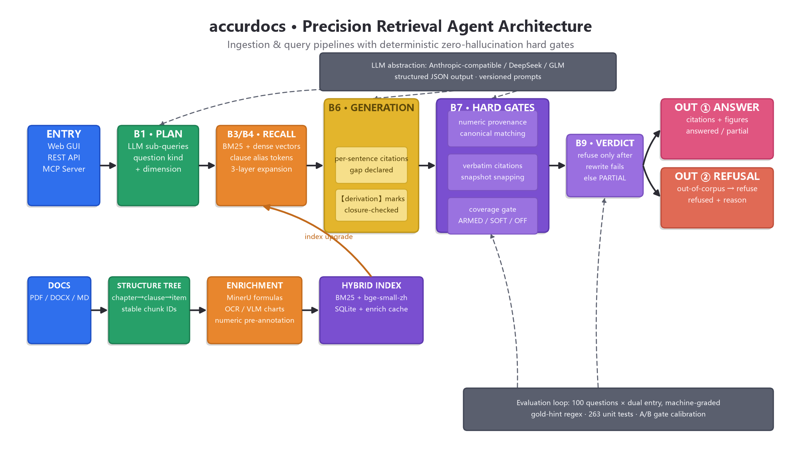

<div align="center">

**English** | [简体中文](README.md)

# accurdocs

**Precision Retrieval & Analysis Agent for Policy / Financial Long Documents**

*Refuse rather than hallucinate — every conclusion is traceable to atomic source fragments*

[](https://github.com/Jaxmy/accurdocs/releases)
[](LICENSE)
[](https://www.python.org/)
[](https://modelcontextprotocol.io/)

</div>

---

## Table of Contents

- [Introduction](#introduction)
- [Features](#features)
- [Components](#components)
- [Key Technologies](#key-technologies)
- [Environment Requirements](#environment-requirements)
- [Installation](#installation)
- [Usage](#usage)
- [How It Works](#how-it-works)
- [Test Results](#test-results)
- [Current Version & Roadmap](#current-version--roadmap)
- [Limitations](#limitations)
- [Contributing](#contributing)
- [License](#license)

## Introduction

accurdocs is a precision retrieval & question-answering agent for long documents such as **policy files, regulatory rules, and brokerage research reports**. Its primary design goals are "every quote verbatim-traceable, every number deterministically verified, refuse rather than hallucinate" — pushing hallucination risk down to the mechanism level rather than the prompt level:

- Every citation must **verbatim match** its source chunk (multi-layer normalized matching + snapshot snap-to-source alignment); a mismatch leads to refusal or to a clearly labeled paraphrase;
- Every number / date / direction word in an answer passes **deterministic provenance verification**; sentences that cannot be traced back to the source are removed or the whole question is refused;
- Question premises (user-supplied numbers) and evidence numbers are strictly separated, with regression tests guarding both false kills and false passes.

Three entry points are provided — **Web GUI, REST API, and MCP Server** — and the MCP server can be mounted directly into any MCP-capable AI client such as Claude Code / Cursor / VS Code.

## Features

| Capability | Description |
|---|---|
| Precision retrieval QA | BM25 + vector hybrid recall; clause-ref / numeric-anchor / same-clause enumeration expansion; per-sentence citation provenance |
| Structured index tree | Automatic recognition of Chinese chapter / section / article / paragraph / item; two-way jumps between the title tree and original PDF page numbers |
| Formula & chart enrichment | Formula LaTeX transcription + symbol table; dual-source OCR/VLM numeric transcription for charts; original figures shown with answers |
| Dual hard gates for numbers & citations | Numeric provenance (incl. direction-word binding); coverage gate against "asked for numbers, answered without them"; verbatim citation verification |
| Smart question classification | Semantic type (enumeration / numeric / comparison / definition / procedure / analysis) + dimension detection, driving gate arming |
| Analytical reasoning | Analysis/comparison questions answered on anchored facts with explicit 【推导】 (derivation) marks, closure-verified; uncovered parts explicitly declared |
| Version adjudication | Multiple versions of one document (doc number / version / draft state) auto-grouped into families — no mixing of old and new versions |
| Dual-entry consistency | Every question is run through both the Web GUI and MCP entry points; any divergence is filed as a bug |

## Components

```
accurdocs/
├── src/policyrag/            # Core package (Python)
│   ├── ingest/               #   Parsing (PDF/DOCX/MD) → structure tree → chunking → enrichment queue
│   │   └── numspan.py        #   Evidence numeric-span pre-annotation (LLM proposes + deterministic validation)
│   ├── index/                #   BM25 / vector / hybrid indexes & metadata store (SQLite)
│   ├── query/                #   Search plan → hybrid recall → generation → verification
│   ├── verify/               #   Deterministic hard gates: numeric provenance / verbatim citation / coverage gate / refusal adjudication
│   ├── llm/                  #   Multi-provider LLM abstraction (Anthropic-compatible / DeepSeek / GLM)
│   ├── service/              #   Orchestration core (QA / ingestion / document management / version grouping)
│   └── adapters/
│       ├── rest/             #   FastAPI + Web GUI (the accurdocs interface)
│       └── mcp/              #   MCP Server (stdio / optional HTTP)
├── config/                   # Retrieval parameters & prompt versions
├── scripts/                  # Query / smoke / repair utilities
├── tests/unit/               # Unit tests
├── start_api.bat             # Start Web GUI + REST (port overridable via ACCURDOCS_PORT)
├── start_mcp.bat             # Start MCP Server (stdio)
├── setup_mcp.py              # One-click MCP mounting script
└── mcp_config_example.json   # MCP configuration templates for each client
```

Full component workflow (ingest chain → hybrid index → query chain → deterministic hard gates → refuse/pass verdict):



## Key Technologies

| Layer | Technology | Purpose |
|---|---|---|
| Service & API | Python 3.12 · FastAPI + Uvicorn · Pydantic | REST API, Web GUI, structured data models |
| AI-client integration | MCP SDK (stdio / optional HTTP transport) | 12 tools mountable into Claude Code / Cursor / VS Code, etc. |
| Hybrid retrieval | rank-bm25 + jieba Chinese tokenization · fastembed (bge-small-zh-v1.5, ONNX) · NumPy | Sparse + dense dual-path recall; clause alias tokens (`§条12`) emitted on both sides; fingerprint guard against vector mixing |
| Document parsing | PyMuPDF · python-docx · markdown-it-py | PDF text/table/page-image extraction; DOCX/MD ingestion; jump to original PDF pages |
| Structure recognition | Custom Chinese structure tree (chapter/section/article/paragraph/item regex + wrap-line merging + heading-continuation / noise-line filtering) | Stable chunk IDs (blake2s); two-way binding between index tree and source pages |
| Formula/chart enrichment | MinerU (formula LaTeX transcription) · RapidOCR (subprocess-isolated) · VLM vision model (dual-source chart numeric transcription) | Formula transcription + symbol tables; strong/weak tiering of chart OCR/VLM results; prioritized enrichment queue (resumable) |
| Numeric pre-annotation | LLM proposes + deterministic adjudication (literal substring + canonical number computable) | Ingestion-time pre-annotation of evidence numeric spans (cross-cell / line-broken values), enforced as a union with runtime regex |
| LLM abstraction | Anthropic SDK / OpenAI SDK / ZhipuAI · JSON-Schema structured output · versioned prompts | Tiered calls for search planning, answer generation, sufficiency review, analytical synthesis |
| Deterministic verification | Numeric canonicalization (full/half-width, Chinese numerals, dual-track ISO dates) · direction-word binding · difflib snapshot snapping · three-state arming (ARMED/SOFT/OFF) | Numeric provenance, verbatim citations, coverage gate, refusal adjudication — zero-hallucination hard gates |
| Storage | SQLite (metadata / enrichment cache / job queue) · content-hash cache (enrich_cache) | Idempotent ingestion; enrichment results reused for free on re-ingestion |

## Environment Requirements

| Item | Requirement |
|---|---|
| Operating system | Windows / macOS / Linux (launcher scripts are Windows bats; on POSIX run `python -m …` directly) |
| Python | 3.12+ (a dedicated venv is recommended) |
| Memory | 8 GB or more recommended (vector indexing and chart enrichment are memory-hungry) |
| LLM API | Any one of: an Anthropic-compatible gateway (API Key or AUTH_TOKEN), DeepSeek, ZhipuAI GLM; **keys go only in the local `.env` — never ingested, never committed** |
| Optional | A vision-capable API (chart numeric transcription); without it, chart-numeric questions are refused by design |
| Network | PyPI access on first install; the embedding model (bge-small-zh) is downloaded once and cached locally |

> All ports, paths, and keys are configured via environment variables / the local `.env`; neither code nor docs are tied to any specific deployment environment.

## Installation

```bash
# 1. Get the code
git clone https://github.com/Jaxmy/accurdocs.git
cd accurdocs

# 2. Create a virtual environment (Python 3.12+)
python -m venv .venv
# Windows:  .venv\Scripts\activate     POSIX:  source .venv/bin/activate

# 3. Install dependencies (fastembed optional: full vector retrieval; without it a hash vector is used for smoke tests only)
pip install -e ".[dev]"
pip install -e ".[embed]"     # optional, recommended

# 4. Configure keys
cp .env.example .env          # Windows: copy .env.example .env
# Edit .env and fill in the LLM provider and key (one of: Anthropic-compatible / DeepSeek / GLM)

# 5. (Windows) Set UTF-8 to avoid garbled CJK console output
set PYTHONUTF8=1              # POSIX:  export PYTHONUTF8=1
```

## Usage

### ① Web GUI + REST API

```bat
start_api.bat
```

Open the address printed by the script in a browser: upload documents (auto-ingestion, auto-enrichment, live progress), ask questions on the QA page, jump to the original PDF, and inspect per-sentence citations. REST API docs are at `/docs` (Swagger).

### ② One-click MCP mounting (recommended for AI clients)

```bash
python setup_mcp.py --claude    # generates .mcp.json and registers with Claude Code
python setup_mcp.py             # other clients: merge the printed mcpServers section into your config
```

Complete configuration templates for each client (Claude Code / Cursor / VS Code / any MCP framework) are in [`mcp_config_example.json`](mcp_config_example.json). Once mounted, 12 tools become callable directly in conversations (QA / retrieval / ingestion / document management / verification):

```
policy_ask (QA with per-sentence citations and figures), policy_search, policy_get_chunks,
policy_ingest, policy_doc_index, policy_list_documents, policy_list_chunks,
policy_delete_document, policy_verify, policy_vision_check, policy_review_list/decide
```

### ③ Command-line ingestion & asking

```bat
ingest.bat "docs\policy.pdf" my-policy 2024-03-01 2024-03-01
python scripts\query.py ask "月度阻塞费用如何计算？"
```

### ④ Smoke self-check

```bash
python -m pytest tests/unit -q        # all unit tests green
python scripts/smoke.py               # end-to-end smoke test
```

## How It Works

The QA path is a determinist-first multi-stage pipeline (B0–B9):

1. **Search plan** (B1): the LLM additionally outputs the question's semantic type (enumeration/numeric/comparison/definition/procedure/analysis) and dimension, used as the first signal for the verification gate; regex detection is demoted to a fallback and cross-check (automatic fallback when the LLM gateway is down).
2. **Hybrid recall** (B3/B4): BM25 (body text + breadcrumb paths + clause alias tokens) and vector search in parallel, with clause-reference ranking boosts; three layers of evidence expansion — same-clause enumeration sibling chunks, heading-family child chunks, and formula-page neighborhood chunks.
3. **Generation** (B6): structured answers with per-sentence citations; analytical questions perform 【推导】 (derivations) only over anchored facts, and parts lacking evidence are explicitly declared as not covered.
4. **Deterministic hard gates** (B7): numeric provenance (user premises vs. evidence numbers on separate whitelists), direction-word binding, a coverage gate against "asked for numbers, answered without them" (three-state arming ARMED/SOFT/OFF), and multi-layer verbatim citation matching (normalized containment → snapshot snapping → loose layers → demoted paraphrase; citations carrying fabricated numbers are never passed).
5. **Refusal adjudication** (B9): refusal happens only when "deterministic verification confirms failure + remedial rewrite still fails"; partially answerable questions get a partial answer with the gap noted.

Ingestion side: PDF/DOCX/MD parsing → Chinese structure tree (chapter/section/article/paragraph/item) → stable chunk IDs → formula/chart enrichment queue (local MinerU formula transcription + dual-source OCR/VLM chart transcription + numeric-span pre-annotation) → progressive hybrid-index upgrades.

## Test Results

The most recent full dual-entry test (100 questions × both Web GUI and MCP entry points; question types covering single question / combined questions / single + analysis / combined + analysis, 25 each, plus 2 out-of-corpus refusal probes; graded by gold-hint regexes + quality red lines, machine-graded):

| Metric | Web GUI | MCP |
|---|---|---|
| Answer rate | 99% | 98% |
| Refusal rate (incl. false refusals) | 1% | 2% |
| Answered accuracy (all gold hints hit / answered) | 95.0% | 99.0% |
| Recall (gold-hint items) | 96.2% | 97.2% |
| Out-of-corpus refusal probes | 2/2 | 2/2 |
| Cross-entry verdict agreement | 93% | |

- Answered accuracy and recall are machine-graded by **per-item gold-hint regex checks**, not subjective scoring.
- Refusal probes verify the product red line "out-of-corpus questions must be refused, never fabricated".
- All 263 unit tests green (covering the numeric/citation hard gates, refusal semantics, structure tree, and formula-chain regressions).

## Current Version & Roadmap

**Current version: v0.4.0** (2026-10)

Shipped: precision QA across three entry points (GUI/REST/MCP), structured indexing with original-PDF jumps, formula/chart enrichment, numeric & citation dual hard gates, verification gates driven by question semantic classification, partial-answer routing, document version grouping, and ingestion-time numeric pre-annotation.

**Not yet implemented / planned:**

| Version | Plan |
|---|---|
| v0.4.x | Refuse out-of-corpus / predictive questions as a whole before decomposition (preventing probes from leaking answers after splitting); further tighten citation discipline in generation prompts |
| v0.5.0 | Numeric pre-annotation into the enrichment job queue (incremental / resumable); full application of table row/column attribution to price-comparison QA; explicit "coverage" labeling on partial answers |
| v0.6.0 | Enhanced multi-document version-diff views; multi-library routing and per-library permissions; incremental-index performance on large libraries |
| v1.0.0 | One-click installers for Linux/macOS; containerized service deployment (Docker); open-sourcing the retrieval evaluation set and automated regression pipeline |

## Limitations

- **Chart numbers depend on vision capability**: without a VLM API Key, in-chart numbers are not transcribed and related numeric questions are refused by design (refuse rather than hallucinate).
- **Formula transcription** relies on the local MinerU toolchain; complex handwritten/scanned formulas may only get the original figure without text transcription.
- **Scanned PDFs** without a text layer must be OCR'd first (otherwise ingestion is rejected).
- **Analytical answers** are strictly anchored to document evidence: inferences not covered by the documents are explicitly declared "evidence does not cover this" — no baseless extrapolation.
- **Knowledge boundary**: only content covered by ingested documents is answered; out-of-corpus questions are always refused.
- High-concurrency / multi-replica deployment is a future goal; the current positioning is a single-machine knowledge base for individuals / small teams.

## Contributing

Issues and PRs are both welcome. Before submitting, please make sure:

1. `python -m pytest tests/unit -q` is all green;
2. No keys, `.env`, or runtime data are committed (`.gitignore` already covers them);
3. Mechanism-level fixes are preferred over case-by-case patches (no per-document special-casing);
4. Prompt changes come with a version bump and regression data.

## License

This project is open-sourced under the [MIT License](LICENSE).

---

<div align="center">

**accurdocs** — every conclusion stands up to verbatim re-checking · [Issues](https://github.com/Jaxmy/accurdocs/issues) · [Releases](https://github.com/Jaxmy/accurdocs/releases)

</div>
